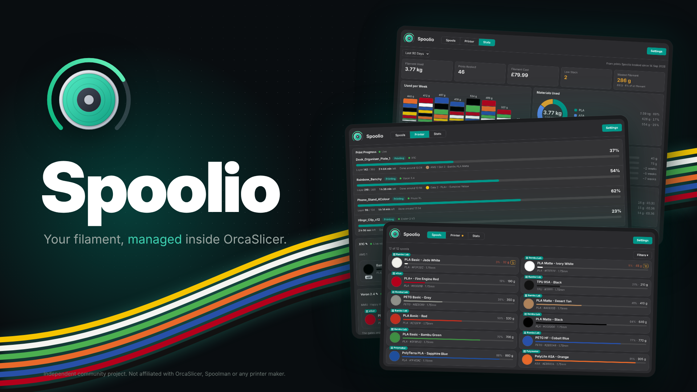
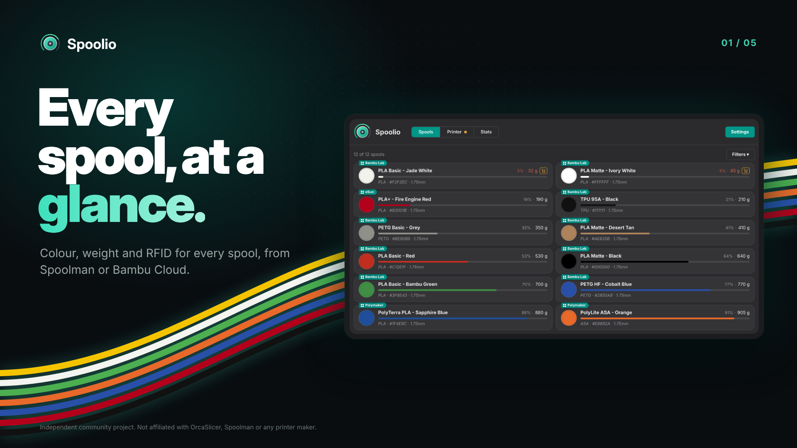
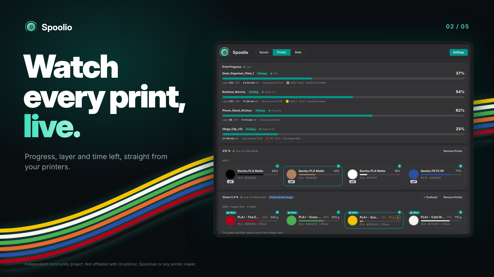
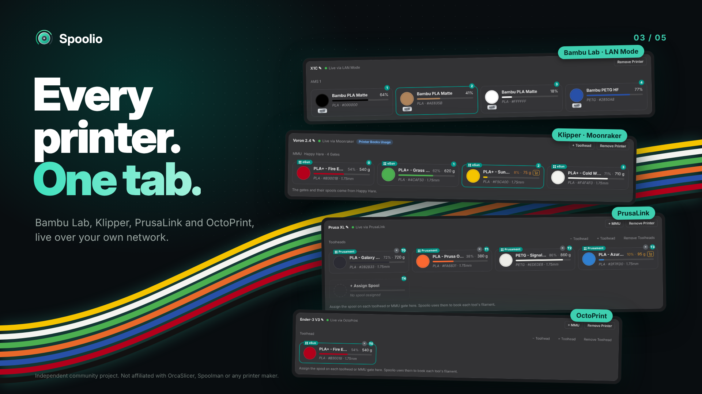
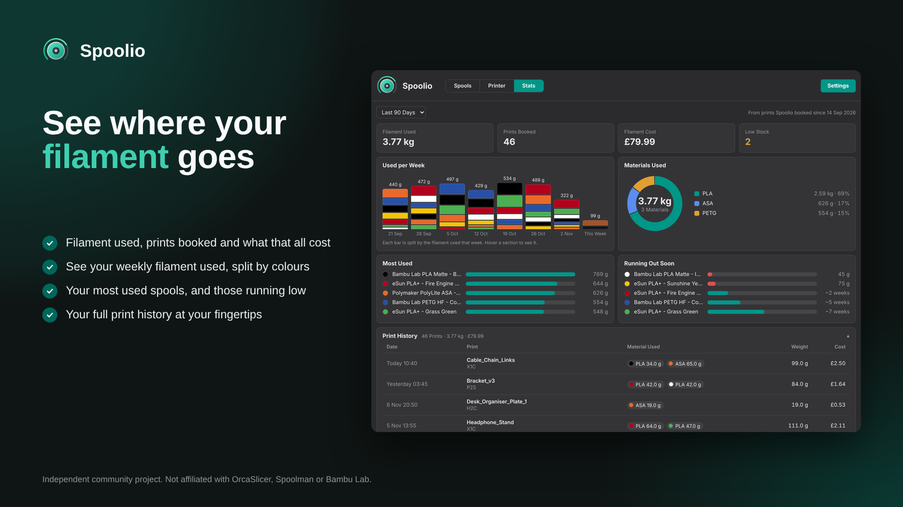
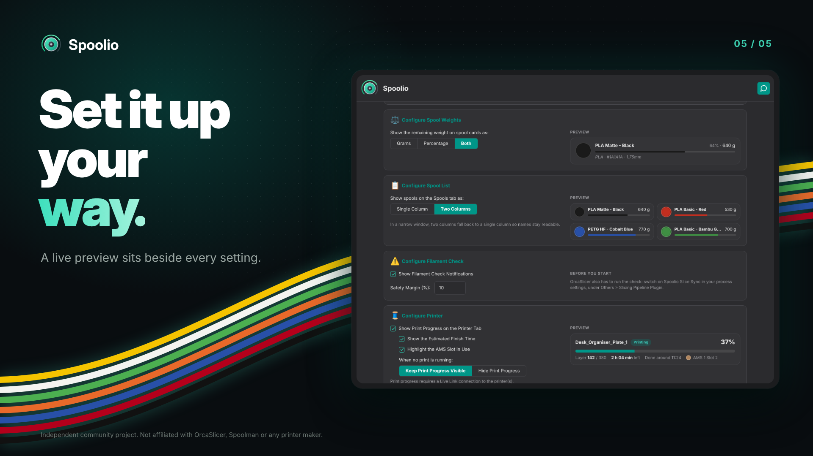

  

# Spoolio for OrcaSlicer

Spoolio is a Bambu Lab inspired filament management plugin for OrcaSlicer. It reads your spools from your self-hosted [Spoolman](https://github.com/Donkie/Spoolman) server or your Bambu Cloud account, shows what is loaded on each of your printers, follows your prints live and books the filament they used back to Spoolman. It works with Bambu Lab, Klipper (Moonraker), PrusaLink and OctoPrint printers.

> [!IMPORTANT]
> Spoolio ***<ins>is not</ins>*** a filament profile manager (nozzle temps, flow ratios, pressure advance etc) those settings are configured in your filament profiles within OrcaSlicer.  If you're looking for a tool that covers this now then I would recommend [PipSpool](https://github.com/Gadonk/pipspool-orcaslicer) or [FilamentHub](https://github.com/WeLizard/FilamentHub). This funtionality will make it's way into Spoolio in future updates.

## Key Features
- **Spool cards:** Showing colour (including multi-colour spools), vendor, remaining weight, a progress bar in the spool's own colour and material / colour hex and diameter details, in one or two columns.
- **Two sources:** Your self-hosted Spoolman server, or your Bambu Cloud account.
- **RFID:** Reads from the spool's `tag` extra field when present, or Spoolman's own `tag` field (requires Spoolman v0.27.0 or newer).
- **Printer tab:** A card per printer showing what is loaded in each AMS, external spool, toolhead or MMU gate. Build your printers by hand and assign your spools to the slots, or link them for live data, with either spool source.
- **Live Link:** Connect directly to your printers on your local network. Bambu Lab printers in LAN mode, Klipper (Moonraker, with Happy Hare gates read from the printer), PrusaLink and OctoPrint.
- **Print Progress:** Every linked printer's job, percentage, layer, time left and finish time in one panel, plus the slot or toolhead feeding the print.
- **Filament usage booking:** With Spoolman, after a print finishes Spoolio books the grams each spool used. Ask first, book automatically or don't track, and undo a booking if you got it wrong.
- **Slice Sync:** After each slice, Spoolio checks you have enough filament loaded, and fills in the spool on each toolhead of your Klipper, PrusaLink and OctoPrint printers from the sliced filaments.
- **Statistics:** Filament used, prints booked and what it cost as well as waste from supports and purge, weekly use by colour, materials, your most used spools and those running low and your full print history.

## Other Features
- **Filter, sort and group:** By material, manufacturer or location.
- **Low-stock warning:** Spools under your low-stock threshold have their remaining weight colour graded as they get closer to empty.
- **Reorder button:** Switch on the cart icon in `Settings` and low-stock spools get a button that opens a web search for the spool's manufacturer and lot number in Spoolman (or the filament name if there's no lot number).
- **Set up your way:** Every setting on the Settings page has a live preview beside it. How cards look, weight as grams, percentage or both, thresholds, print progress, stats currency and more.
- Matches OrcaSlicer's **light and dark theming**.
- Built for **Windows, macOS and Linux** (x86_64 and arm64).

## Images

  

  

  

  

  

  

## Requirements

- A current OrcaSlicer 2.5.0+ build.
- A self-hosted Spoolman server (v0.27.0 or newer required to show RFID tags), or a Bambu Cloud account.
- For Live Link: a printer on the same network as your computer. Bambu Lab printers need LAN mode on. Klipper, PrusaLink and OctoPrint support hasn't been tested on real hardware yet.

## Install

**From Orca Cloud:** subscribe to Spoolio in the Plugin Hub, then in
OrcaSlicer open ***File > Plugins***, click ***Refresh*** and tick ***Activate***.

**Manually:** download the file for your system from the [latest release](../../releases/latest):

| System | File |
|---|---|
| Windows (x86_64) | `spoolio_win_x86_64.py` |
| Windows (arm64) | `spoolio_win_arm64.py` |
| Linux (x86_64) | `spoolio_linux_x86_64.py` |
| Linux (arm64) | `spoolio_linux_arm64.py` |
| macOS (Apple silicon) | `spoolio_macosx_arm64.py` |
| macOS (Intel) | `spoolio_macosx_x86_64.py` |

Place it in its own folder called `spoolio` inside OrcaSlicer's plugin directory (one Spoolio file per folder):

| OS | Plugin directory |
|---|---|
| Windows | `%APPDATA%\OrcaSlicer\orca_plugins\` |
| macOS | `~/Library/Application Support/OrcaSlicer/orca_plugins/` |
| Linux | `~/.config/OrcaSlicer/orca_plugins/` |

Restart OrcaSlicer, then tick ***Activate*** for Spoolio. A **Spoolio** tab appears in the top bar.

## Set Up

The Spoolio tab opens on its Settings page on first run. Enter your Spoolman server address (for example `http://raspberrypi.local:7912`), click ***Test***, once the connection is confirmed then ***Save & Close***, which takes you back to your spool list. Reopen the page any time with the ***Settings*** button.

Prefer Bambu Cloud? Choose ***Bambu Cloud*** under ***Choose Your Source***, enter your Bambu email and password, pick Global or China, and enter the verification code if Bambu asks for one. Spoolio never stores your password, only the sign-in token Bambu returns, and ***Sign Out*** removes it.

OrcaSlicer asks before a plugin does anything sensitive. Expect a prompt the first time the plugin connects to Spoolman or Bambu Cloud, and another the first time you click a reorder cart to open your browser.

> [!NOTE]
> ### Printer Tab
> The **Printer** tab sits beside **Spools** and shows a card for each of your printers. Click ***+ Add Printer***, then add an AMS, or an external spool (or toolheads and an MMU for Klipper, PrusaLink and OctoPrint printers) to match your setup, and use ***+ Assign Spool*** to choose which of your spools is in each slot. This is stored in Spoolio only and nothing is changed in Spoolman or Bambu Cloud. With Bambu Cloud, spools your library has linked to a slot also show, but that can lag behind what is physically loaded.
>
> ### Live Link
> To read a printer directly, press ***Live Link*** on its card and pick the ***Printer Type***:
> - **Bambu Lab:** enter its IP address and access code, found in the printer's network settings with LAN mode on. The serial number is read from the printer automatically; you only need to type it if the printer asks for it.
> - **Klipper (Moonraker):** enter the address you open Mainsail or Fluidd with. An API key is only needed if Moonraker asks for one. If you run Happy Hare, the gates and their colours come straight from the printer.
> - **PrusaLink:** enter the printer's address and the username and password from ***Settings > Network > PrusaLink*** on the printer.
> - **OctoPrint:** enter its address and an application key made under ***Settings > Application Keys***.
>
> Linked printers show **Live via LAN Mode**, **Live via Moonraker**, **Live via PrusaLink** or **Live via OctoPrint**, and their jobs appear in **Print Progress** at the top of the tab. Spoolio keeps access codes and keys in a private file on your computer and only reads from the printer. Removing a printer also removes its Live Link.
>
> ### Filament Usage Booking
> With Spoolman as your source and a Live Link on the printer, Spoolio can book the filament a print used. Under ***When a Print Finishes*** choose ***Ask Me Before Booking***, ***Book Automatically*** or ***Do Not Track***.
> - **Bambu Lab:** when a print starts, Spoolio downloads the job's `.3mf` from the printer and uses the grams it lists for each slot, falling back to your sliced G-code if it can't. Each slot's spool is matched to your Spoolman spools by RFID: the `tag` extra field on the spool (or the long serial Bambu uses for RFID detection).
> - **Klipper, PrusaLink and OctoPrint:** the grams come from the print file, booked to the spool you assigned to each toolhead or gate. You're always asked before these are booked.
>
> Your last five prints sit under **Recent Bookings**, where you can change the spool or grams before booking. Once booked, ***Undo*** adds the weight back to each spool in Spoolman. Slots whose spool can't be identified, cancelled prints (estimated from the progress) and prints that finished while Spoolio wasn't connected always need booking by hand, and nothing is booked twice. Bambu Cloud has no booking, as there is no way to write to its filament library.
>
> ### Statistics
> The **Stats** tab is built from the prints Spoolio books, so it starts filling once booking is on. Pick a period to see filament used, prints booked, cost, low stock and wasted filament including that from supports and purge,, weekly use split by colour, materials, your most used spools, those running low with a rough time left, and how much went on the model with your most wasteful prints. Calibration prints (flow rate, pressure advance, temperature and retraction towers, input shaping tests and the like) are recognised by their name and shown as their own **Calibration** slice and chip in your print history, so they don't count as waste. Costs come from your spool prices in Spoolman. You can switch the tab off or change the currency symbol under ***Configure Stats*** in Settings. History keeps being recorded while the tab is hidden.

> [!IMPORTANT]
> ### Bambu Cloud Limitations
> - **Unofficial and experimental.** This uses Bambu's unofficial cloud service, which Bambu can change without notice. If it stops working, sign out and back in, if that still fails then please report it.
>     - **Sign-in expires.** Spoolio keeps only the sign-in token, not your password, so when Bambu expires the token you'll be asked to sign in again from Settings.
> - Spoolio can only ***read*** your Bambu filament library but cannot write to it, so nothing you do in Spoolio changes your Bambu spools.
> - Filament usage booking is ***<ins>only</ins>*** available with Spoolman. Spoolio has no way to write used weight back to the Bambu library.
> - There is no live AMS through the cloud. A printer in LAN mode isn't bound to your account, so Bambu Cloud doesn't list it and sends no AMS data. Use ***Live Link*** (works with either source) for live slots, or assign spools by hand.
> - The spools your library has linked to a slot are a representative view only and can differ from what is physically loaded.
> - The Printer tab setup is local. Printers, slots and assignments you set up are stored in Spoolio on your computer, not in your Bambu account.
>
> ### Live Link and Booking Limitations
> - Live Link needs the printer on the same network as your computer, and only connects while the Printer tab is open or usage booking is on.
> - Klipper, PrusaLink and OctoPrint printers are checked every 3 seconds while printing and every 15 seconds when idle, so a new print can take a few seconds to appear.
> - If Moonraker is linked to Spoolman, or an OctoPrint Spoolman plugin is installed, the printer may already book its own usage. Spoolio warns you, so check Spoolman before booking those prints.
> - PrusaLink printers with more than one toolhead don't report which one is printing, so no toolhead is highlighted.
> - Undo sets the spool's used weight in Spoolman back by the booked amount. If you changed that spool's weight in Spoolman since, check it after undoing.

> [!TIP]
> ### Slice Sync
> After each slice, Spoolio compares the filament the plate needs with what is left on your spools. You get a short-lived notification when there is enough, and one that stays until you dismiss it when there may not be enough filament loaded.
>
> To use it, switch on ***Spoolio Slice Sync*** in your process settings, under ***Others > Slicing Pipeline Plugin***. If you used it before 0.10.0, when it was called Spoolio Filament Check, you may need to switch it on again. The results also appear in a **This Plate** panel on the Printer tab, where **Re-check** runs it again with fresh data and **Dismiss** hides it until the next slice. You can hide the notifications and the panel, or change the safety margin (10% by default), on the Settings page.
>
> - Each filament the plate uses is matched to spools in Spoolman by vendor, material and colour. Slots that hold the same filament are treated as one supply, because the AMS moves on to the next spool of the same filament when one runs out: their use is added together and compared with the spools' combined weight. Spare spools that aren't loaded never count towards it.
> - If a matching spool is too low to cover the print on the plate, and you have another spool available to the one that is loaded, you get a warning to make sure the right spool is loaded. Archive finished spools in Spoolman so they aren't counted.
> - If no spool matches, or Spoolman can't be reached, you get a short note and nothing else.
> - Slicer figures are estimates and real use can differ a little, so the safety margin gives you headroom.
> - Multi-colour spools are matched on their main colour only.
>
> **Toolheads from your slice.** When you slice for a linked Klipper, PrusaLink or OctoPrint printer, Slice Sync also matches each sliced filament to your spools and fills in its toolheads (or MMU gates). One match is set straight away, several ask you to pick. With more than one of these printers linked, the Printer tab asks which OrcaSlicer printer belongs to which, and you can turn it off per printer under Live Link. Bambu printers and Happy Hare gates are left alone, as they report their own.

## Feedback

Encounter a problem or have an idea? Please
[report a bug](../../issues/new?template=bug_report.yml) or
[request a new feature](../../issues/new?template=feature_request.yml).

## Acknowledgements

- [**Spoolman**](https://github.com/Donkie/Spoolman) by Donkie and contributors.
- [**OrcaSlicer**](https://github.com/OrcaSlicer/OrcaSlicer) by SoftFever and
  contributors.
- The **Bambu Handy** app, whose spool cards inspired the design.

This is an independent project and is not affiliated with or endorsed by Spoolman, OrcaSlicer, Bambu Lab, Prusa Research, Klipper or OctoPrint.

## License

From 0.10.0, Spoolio is licensed under the [PolyForm Shield License 1.0.0](LICENSE). You can use, change and share it, just not to build a competing product. Versions 0.9.6 and earlier remain under the GNU General Public License v3.0. Contributions need the agreement in [CONTRIBUTING.md](CONTRIBUTING.md).
